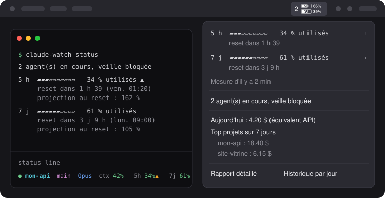
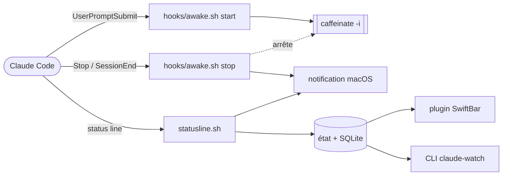

<div align="center">

# ☕ claude-watch

**Le Mac reste éveillé tant qu'un agent Claude Code travaille.<br>Les quotas se lisent d'un coup d'œil dans la barre de menus.**




<sub>Illustration de l'affichage, avec des valeurs d'exemple.</sub>

</div>

## Pourquoi

Un agent lancé pour vingt minutes s'arrête net si le Mac s'endort. Et rien ne dit, sans ouvrir `/usage`, si le quota tiendra jusqu'au reset. claude-watch règle les deux avec quelques scripts shell :

| | |
| --- | --- |
| ☕ **Veille** | `caffeinate` démarre quand tu envoies un prompt et s'arrête quand l'agent a fini. |
| 🔋 **Barre de menus** | Nombre d'agents actifs et deux batteries, 5H et 7J, qui se vident avec les quotas (via SwiftBar). |
| ⌨️ **Status line** | Projet, branche, modèle, contexte et quotas dans Claude Code, en couleurs. |
| 🗄️ **Historique** | Coût par projet, par modèle et par jour, dans une base SQLite locale. |
| 🔔 **Alertes** | Notification à 80 % puis 95 % d'un quota, et à la fin d'un tour d'agent de plus de 5 minutes. |

Aucun appel réseau, aucun jeton à fournir : tout vient du JSON que Claude Code transmet à la status line.

## Sommaire

- [Installation](#installation)
- [Lecture de l'affichage](#lecture-de-laffichage)
- [CLI](#cli)
- [Configuration](#configuration)
- [Fonctionnement](#fonctionnement)
- [Limites](#limites)
- [Tests](#tests)

## Installation

```bash
brew install jq
brew install --cask swiftbar   # à lancer une fois pour choisir le dossier de plugins
./install.sh
```

`install.sh` peut être relancé sans risque. Il :

1. crée le lien `~/.claude/claude-watch` vers ce repo ;
2. ajoute les hooks `UserPromptSubmit`, `Stop` et `SessionEnd` dans `~/.claude/settings.json`, après une sauvegarde horodatée et sans toucher aux autres réglages ;
3. configure la status line, sauf si une autre est déjà en place (`./install.sh --force` pour la remplacer) ;
4. lie le plugin dans le dossier SwiftBar et la CLI dans `~/.local/bin` ou `~/bin` s'ils existent.

L'icône de la barre de menus est dessinée par `python3` (celui de macOS suffit, aucune dépendance) ; sans lui, la barre affiche le même contenu en texte.

Les sessions Claude Code déjà ouvertes doivent être relancées. `claude-watch doctor` vérifie l'installation.

Pour désinstaller : `./uninstall.sh` (`--purge` supprime aussi l'historique).

## Lecture de l'affichage

### Barre de menus

Le chiffre de gauche est le nombre d'agents Claude Code qui travaillent en ce moment (la veille est bloquée tant qu'il n'est pas à zéro). Suivent deux batteries, une par fenêtre de quota :

| Élément | Sens |
| --- | --- |
| `2` | deux agents en cours ; un `0` atténué quand rien ne tourne |
| batterie `5H` | quota de la fenêtre de 5 heures |
| batterie `7J` | quota de la fenêtre de 7 jours |
| pourcentage | ce qu'il **reste** du quota, comme pour une batterie |
| rouge | il reste 20 % ou moins |

Le menu déroulant détaille chaque fenêtre avec une jauge de ce qui est **utilisé**, le temps avant le reset et, en sous-menu, le rythme et la projection :

```
5 h  ▰▰▰▱▱▱▱▱▱▱   34 % utilisés   reset dans 1 h 39
7 j  ▰▰▰▰▰▰▱▱▱▱   61 % utilisés   reset dans 3 j 9 h
```

Il donne aussi le coût du jour et les projets les plus consommateurs sur 7 jours.

### Status line

```
● mon-api  main  Opus  ctx 42%   5h 34%▲   7j 61%
```

| Élément | Sens |
| --- | --- |
| `●` vert / `○` gris | veille bloquée pour cette session, ou non |
| `mon-api  main  Opus` | projet, branche git, modèle |
| `ctx 42%` | remplissage de la fenêtre de contexte |
| `5h 34%`, `7j 61%` | quota **utilisé** : vert, jaune à 80 %, rouge à 95 % |
| `▲` | consommation plus rapide que le temps qui passe : le quota sera épuisé avant le reset |
| `↻1h39` | temps avant le reset, affiché à partir de 80 % |

### Rythme

Le rythme compare le pourcentage consommé au pourcentage de la fenêtre écoulé. Exemple : 60 % du quota hebdo après 30 % de la semaine donne ▲ et une projection à 200 %. La projection n'est affichée qu'après 10 % de la fenêtre, avant elle ne veut rien dire.

## CLI

```
claude-watch status            agents actifs, quotas et rythme
claude-watch history [jours]   une ligne par jour (14 par défaut)
claude-watch report [jours]    coût par projet et par modèle (7 par défaut)
claude-watch doctor            dépendances et installation
claude-watch paths             chemins utilisés
```

La base se requête aussi directement : `sqlite3 ~/.local/state/claude-watch/history.db`, table `samples` et vue `deltas` (coût de chaque intervalle).

## Configuration

Optionnelle : copier `config.example` dans `~/.config/claude-watch/config`. On peut y régler la durée maximale de `caffeinate`, ses options, les seuils d'alerte, la marge du rythme, les couleurs de la status line et l'icône de la barre (seuil du rouge, thème, repli en texte).

## Fonctionnement



| Fichier | Rôle |
| --- | --- |
| `hooks/awake.sh` | Lance et arrête `caffeinate`, notifie la fin des tours longs. |
| `statusline.sh` | Affiche la status line, écrit les quotas et l'historique, déclenche les alertes. |
| `swiftbar/claude-watch.5s.sh` | Plugin de barre de menus, rafraîchi toutes les 5 secondes. Il ne fait que lancer `lib/menu.sh`. |
| `lib/menu.sh` | Titre et menu déroulant. Il lit l'état et ne garde qu'un cache de l'icône. |
| `lib/render_bar.py` | Dessine l'icône (agents et batteries) en PNG, avec la seule bibliothèque standard. |
| `bin/claude-watch` | CLI : état, historique, rapports, diagnostic. |
| `lib/common.sh` | Fonctions partagées : état, base, calcul du rythme, jauges, notifications. |
| `tools/make_glyphs.py` | Outil de développement : régénère `lib/glyphs.dat`, les caractères de l'icône (police Inter, licence OFL). |

L'état vit dans `~/.local/state/claude-watch/` : un pid `caffeinate` par session, la dernière mesure de quota, la base `history.db`.

## Limites

- **Quotas** : disponibles seulement avec un abonnement Pro ou Max, et après la première réponse d'une session. Le quota hebdomadaire par modèle affiché par `/usage` n'est pas transmis à la status line.
- **Fraîcheur** : la mesure ne bouge que lorsqu'une session Claude Code tourne. L'usage fait ailleurs (claude.ai, autre machine) n'apparaît qu'à la session suivante ; le menu indique l'âge de la mesure.
- **Coûts** : c'est le coût équivalent API calculé par Claude Code, pas une facture. Il sert à comparer projets et modèles entre eux.
- **Batterie rouge et thème** : tant que rien n'est rouge, l'icône prend d'elle-même la couleur de la barre. Avec du rouge, elle suit le mode clair ou sombre de macOS ; si le texte de ta barre est clair en mode clair (fond d'écran sombre), force `CLAUDE_WATCH_BAR_THEME=dark`.
- **Écran rabattu sur batterie** : macOS met en veille malgré `caffeinate`. Il faut le secteur et un écran externe.
- **Interruption avec Échap** : le hook `Stop` peut ne pas se déclencher. `caffeinate` s'arrête alors au prompt suivant, à la fin de la session ou après 4 h.
- **Tour de plus de 4 h** : `caffeinate` expire avant la fin, augmenter `CLAUDE_WATCH_MAX_SECONDS`.

## Tests

```bash
./tests/run.sh
```

Les tests simulent `caffeinate` et les notifications, ils tournent aussi sous Linux (il faut `jq`, `sqlite3` et `python3`).
